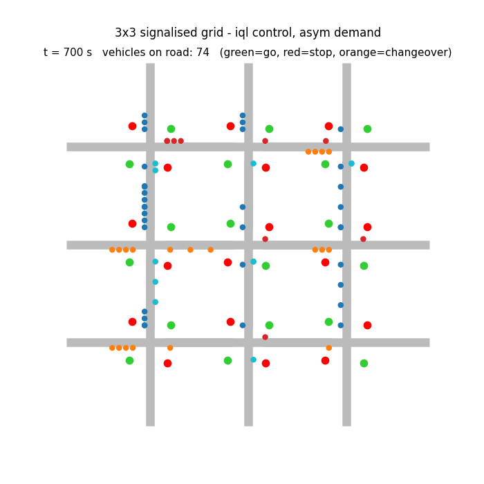
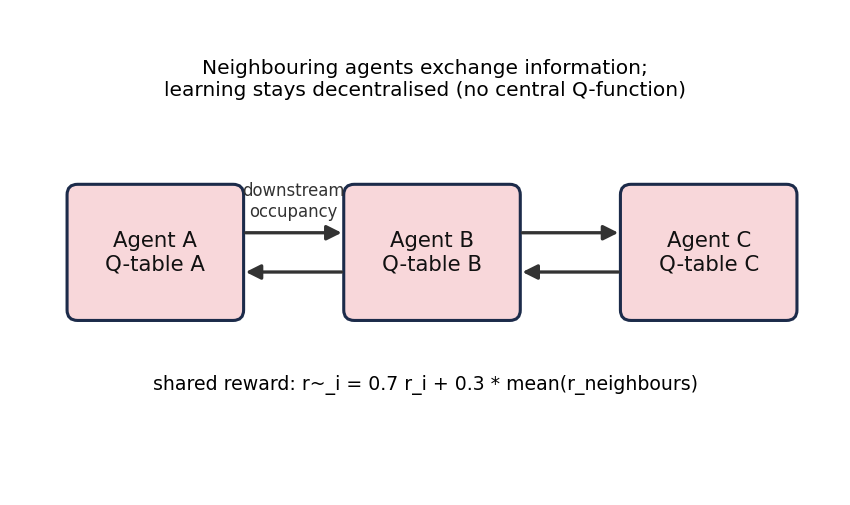
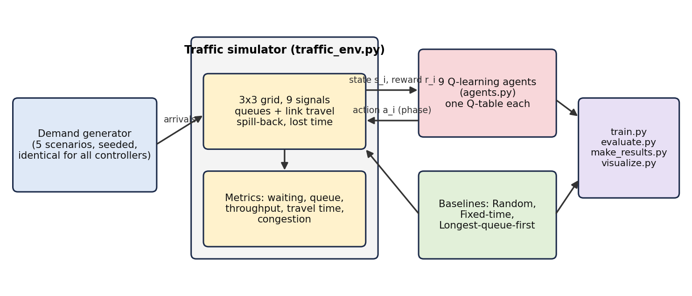
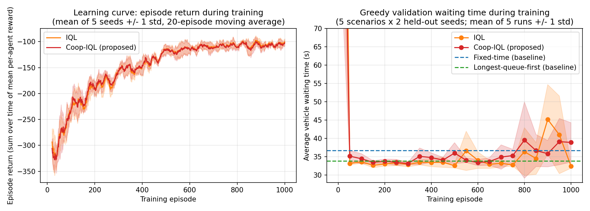
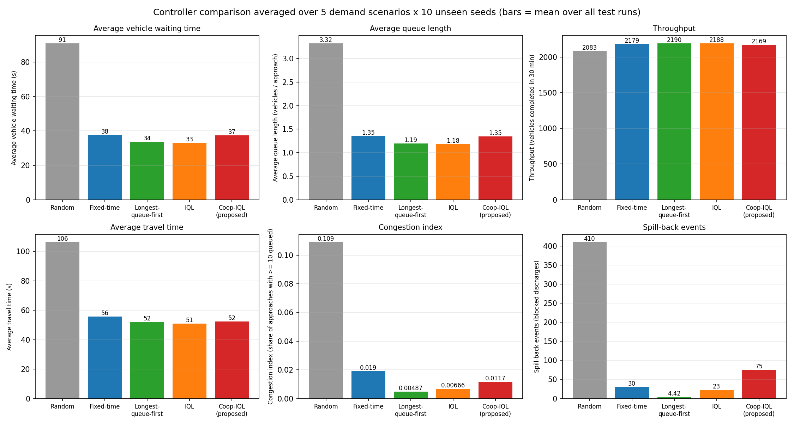
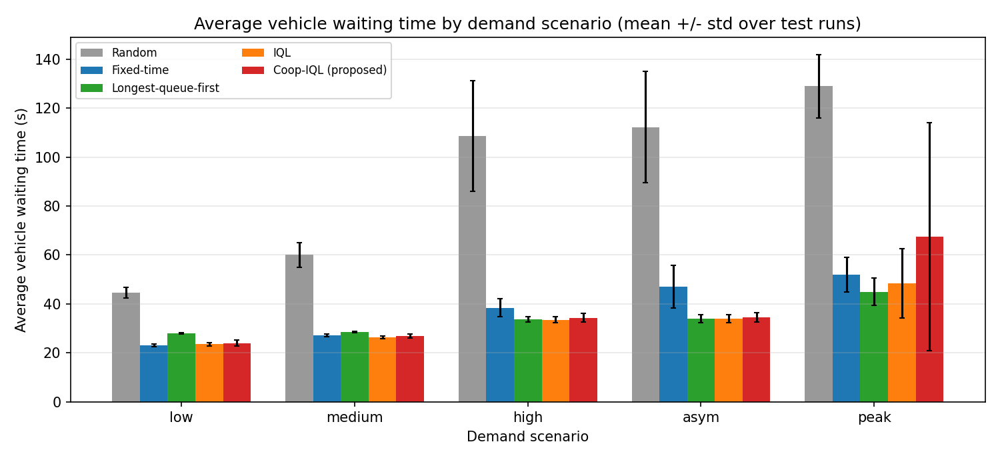
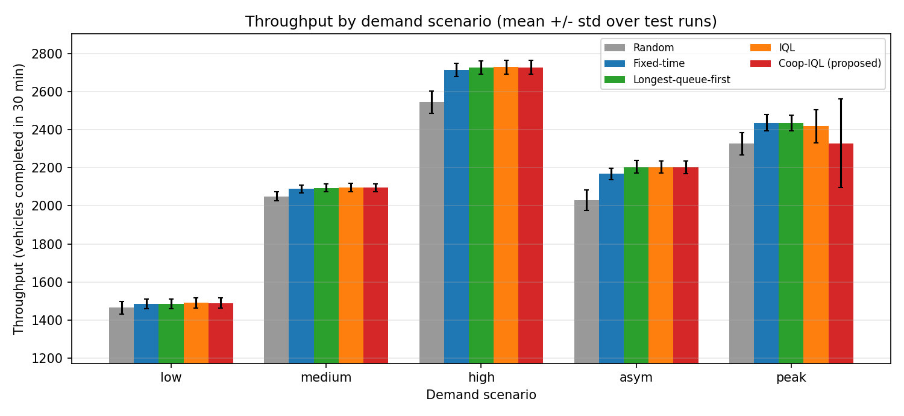

# Traffic Signal Coordination using Multi-Agent Reinforcement Learning

**Project 10, Unit 5: Real-World RL Homework Projects**

*Intelligent Multi-Agent Traffic Signal Coordination Using Reinforcement Learning for Urban Traffic Congestion Optimization*



*Animation from our simulator: vehicles queue at red lights and are released when the signal turns green (green = go, red = stop, orange = 2 s changeover).*

## Problem statement

Assigned topic: "Traffic-signal coordination - Multiple agents control intersections in SUMO or CityFlow to reduce average waiting time."

In this project each intersection is an agent that learns when to switch its signal so that traffic flows better across a network of intersections. The assignment suggests SUMO or CityFlow; because of installation and reproducibility constraints on Windows we used a custom Python simulator instead and say so throughout.

Fixed-time signals repeat the same cycle whatever the traffic, so green time is wasted on empty approaches while queues grow elsewhere, and a full queue at one junction can block the next. We let every signal learn from experience which phase to show, and let neighbouring signals share information.

## Objectives

1. Build a reproducible multi-intersection traffic simulator with variable demand.
2. Implement one independent RL agent per signal, with state, action and reward definitions suited to traffic.
3. Add cooperation between neighbouring agents (information sharing and reward sharing).
4. Compare against Random, Fixed-time and Longest-queue-first baselines on identical traffic.
5. Measure waiting time, queue length, throughput, travel time and congestion, and report the results honestly, including unfavourable ones.

## About the project

- **Simulator:** a custom, lightweight Python queue-based simulator (`04_Source_Code/traffic_env.py`). **SUMO was not used.** It needs only `pip` packages, runs on Windows and needs no API keys.
- **Network:** 3x3 grid of 9 two-phase signalised intersections, 12 boundary entry points, individually tracked vehicles on fixed routes, spill-back when a downstream approach is full.
- **Algorithms:** Independent Q-Learning (IQL), a cooperative variant (Coop-IQL), and three non-learning baselines.
- **Setup:** 1000 training episodes x 5 independent runs per RL method; evaluation on 5 demand scenarios x 10 unseen seeds with identical arrivals for every controller.
- **Result in one line:** IQL lowered the average waiting time by about 12% compared with Fixed-time (about 28% under asymmetric demand) and was roughly on par with Longest-queue-first. The cooperative variant we proposed **did not** beat IQL and was unstable in 3 of 5 training runs under peak demand.

## Reinforcement learning methodology

Each intersection *i* is an agent in a decentralised multi-agent MDP.

| Component | Definition |
|---|---|
| **State** | Queue on the N+S axis and on the E+W axis (each in 4 levels: 0-3, 4-9, 10-19, 20+), current phase (2), longest head-of-queue wait of the red axis (3 levels: <15 s, 15-40 s, >40 s) = 96 states. Coop-IQL adds two binary flags "a downstream approach this axis feeds is at least 60% full" = 384 states. |
| **Action** | Phase for the next 10 s: 0 = north-south green, 1 = east-west green. Changing phase inserts 2 s of all-red. |
| **Reward** | `r_i = -(0.10 * avg_queue_i + 0.50 * max_head_wait_i / 60 + 0.50 * min(blocked_i / 5, 2))` - penalises queues, waiting and spill-back. |
| **Shared reward (Coop-IQL)** | `r~_i = 0.7 * r_i + 0.3 * mean(r_j for neighbours j)` |
| **Algorithm** | Tabular Q-learning, one Q-table per agent: `Q(s,a) <- Q(s,a) + alpha * [r + gamma * max Q(s',a') - Q(s,a)]`, alpha = 0.1, gamma = 0.9, epsilon-greedy decayed linearly 1.0 -> 0.05 over the first 700 of 1000 episodes. |
| **Objective** | Each agent maximises its discounted return; the network goal is to minimise average vehicle waiting time. |

**Multi-agent interaction.** All 9 agents act simultaneously every 10 s, so each faces a changing environment (non-stationarity). Coop-IQL is decentralised - there is no central Q-function or controller.



## Algorithms and techniques implemented

| Controller | Description |
|---|---|
| Random | Uniformly random phase every 10 s |
| Fixed-time | All junctions alternate 20 s NS / 20 s EW (40 s cycle, no offsets, not tuned) |
| Longest-queue-first | Extra heuristic: switch to the axis with the larger queue when it exceeds the current one by more than 2 vehicles |
| **IQL** | Independent Q-learning, local state and local reward |
| **Coop-IQL (proposed)** | IQL + downstream-fullness information + reward sharing |

## System architecture and workflow



1. Each training episode draws a random demand scenario and seed; 1800 s are simulated, with one decision per agent every 10 s.
2. Each agent observes its state, chooses a phase (epsilon-greedy), receives its reward and applies the Q-learning update.
3. After training, greedy policies and baselines are evaluated on 50 unseen, identical demand realisations.
4. Charts, tables, the report and the slides are generated from the result files by script.

## Simulation environment

| Parameter | Value |
|---|---|
| Network | 3x3 grid, 9 signals, 12 entry points |
| Link travel time / queue limit | 8 s / 20 vehicles (queued + on link) per internal approach |
| Discharge / lost time | one vehicle per 2 s per green approach / 2 s all-red on phase change |
| Episode / decision interval | 1800 s / 10 s |
| Routing | dimension-ordered (columns, then rows) to a random boundary exit; no re-routing |
| Demand scenarios (veh/s per entry) | `low` 0.07, `medium` 0.10, `high` 0.13, `asym` 0.16 for southbound/eastbound entries and 0.05 for the others, `peak` rising 0.05 to 0.18 and back to 0.05 |

Not modelled: left turns, pedestrians, yellow phases, vehicle dynamics, lane changing, re-routing. Absolute numbers are properties of this simulator, not predictions for real roads.

## Experimental setup

- **Training:** 1000 episodes x 5 independent runs (seeds 0-4) for each of IQL and Coop-IQL, random scenario per episode (demand seeds 0-999). About 10 minutes on one CPU core.
- **Testing:** 5 scenarios x 10 unseen demand seeds (1000-1009), 1800 s each; the same vehicle arrivals for every controller. RL controllers run greedily (epsilon = 0), each of the 5 trained runs on all 50 realisations.
- **Validation during training:** seeds 5000-5001.
- **Metrics:** average waiting time (time spent queued, including vehicles still queued at the end), average queue length (vehicles per approach), throughput (vehicles that left in 30 min), average travel time (completed trips only), congestion index (share of approaches holding at least 10 queued vehicles), spill-back events.

## Results and performance analysis

Mean over all scenarios and test runs (full tables: `05_Experimental_Results/results_overall.md`, `results_by_scenario.csv`):

| Controller | Avg wait (s) | Avg queue (veh/approach) | Throughput (veh/30 min) | Avg travel time (s) | Congestion index |
|---|---|---|---|---|---|
| Random | 90.8 | 3.32 | 2083 | 106.3 | 0.109 |
| Fixed-time | 37.5 | 1.35 | 2179 | 55.8 | 0.019 |
| Longest-queue-first | 33.8 | 1.19 | 2190 | 52.2 | 0.005 |
| **IQL** | **33.1** | **1.18** | 2188 | **50.9** | 0.007 |
| Coop-IQL (proposed) | 37.4 | 1.35 | 2169 | 52.3 | 0.012 |

Average waiting time (s) by demand scenario:

| Controller | low | medium | high | asym | peak |
|---|---|---|---|---|---|
| Random | 44.5 | 60.0 | 108.6 | 112.2 | 129.0 |
| Fixed-time | 23.1 | 27.1 | 38.4 | 47.1 | 52.0 |
| Longest-queue-first | 27.9 | 28.6 | 33.6 | 33.8 | 45.0 |
| IQL | 23.5 | 26.4 | 33.5 | 33.9 | 48.4 |
| Coop-IQL (proposed) | 24.0 | 26.9 | 34.3 | 34.5 | 67.5 |

**Findings**

- IQL gave the lowest average waiting time, queue length and travel time: about 12% lower waiting time than Fixed-time overall, about 28% lower under `asym` demand, and roughly on par with Longest-queue-first (a 1.9% difference, small relative to run-to-run variation).
- Learning pays off mainly when demand is high or unbalanced. At low demand Fixed-time and IQL are almost equivalent, and Longest-queue-first is worse than Fixed-time there.
- Throughput differs little between sensible controllers: in 30 minutes almost all vehicles get through unless the network gridlocks. The benefit appears in waiting time and queues.
- **Negative result:** Coop-IQL averaged 37.4 s, no better than Fixed-time and worse than IQL. In the `low`, `medium`, `high` and `asym` scenarios it is within about 1 s of IQL, but under `peak` demand 3 of 5 Coop-IQL runs ended with about 80 s waiting time versus 0 of 5 IQL runs. We did not run ablations separating information sharing from reward sharing, so the cause is untested.
- Greedy validation performance is already competitive after about 50 episodes; late in training the validation curves oscillate (constant learning rate, learning neighbours).

**Design iteration (full disclosure).** A first version of Coop-IQL (neighbour mean queue as shared information, 400 episodes) also failed under peak demand (average wait: IQL 36.2 s, Coop-IQL 43.4 s; archived in `05_Experimental_Results/iteration1_v1_400ep/`). We then switched to downstream-fullness flags and trained for 1000 episodes. This redesign was motivated by seeing those test results, so the test seeds are not completely untouched. The final design is still outperformed by plain IQL.

## Visualizations and screenshots

| Learning curves (training return and validation waiting time) | Overall comparison |
|---|---|
|  |  |

| Waiting time by scenario | Throughput by scenario |
|---|---|
|  |  |

Also in `05_Experimental_Results/`: `queue_length_by_scenario.png`, `travel_time_by_scenario.png`, and the animations `simulation_iql_asym.gif` (learned IQL policy) and `simulation_fixed_asym.gif` (Fixed-time), each with a `_snapshot.png` frame.

## Project folder structure

```
Traffic-Signal-Coordination/
├── README.md
├── requirements.txt
├── 01_Project_Report/
│   └── RL_Traffic_Signal_Coordination_Report.pdf      full report (9 pages)
├── 02_Problem_Formulation/
│   └── Problem_Formulation_One_Page.pdf               one-page problem formulation
├── 03_Presentation/
│   └── RL_Traffic_Signal_Coordination_5_Slides.pptx   five-slide presentation
├── 04_Source_Code/
│   ├── config.py            constants (network, demand, reward, Q-learning, seeds)
│   ├── traffic_env.py       simulator + demand generator
│   ├── agents.py            baselines, IQL and Coop-IQL agents
│   ├── train.py             training (IQL and Coop-IQL, 5 runs each)
│   ├── evaluate.py          evaluation on 5 scenarios x 10 seeds
│   ├── make_results.py      charts and tables
│   ├── visualize.py         GIF animation of vehicles and signals
│   ├── make_architecture.py diagrams
│   ├── build_documents.py   builds the report and one-page PDFs
│   ├── build_presentation.py builds the slides
│   ├── run_all.py           whole pipeline in one command
│   ├── README.md            source-level notes
│   └── tests/test_env.py    5 unit tests
├── 05_Experimental_Results/
│   ├── *.png, *.gif         learning curves, comparison charts, animations
│   ├── results_overall.md, results_wait_by_scenario.md, results_by_scenario.csv, paired_comparison_wait.json
│   ├── evaluation_raw.json, training_logs.json, training_log.txt, trained_q_tables.pkl
│   └── iteration1_v1_400ep/   archived first design (see "Design iteration")
└── 06_Documentation/
    └── Handover_Summary.md
```

## Dependencies and installation

Python 3.10 or newer. Dependencies (`requirements.txt`): NumPy, Matplotlib, Pillow, ReportLab, python-pptx. No paid APIs or keys are needed.

The code was developed and run on Linux with Python 3.12. The Windows commands below were **not** executed on a Windows machine.

```
cd Traffic-Signal-Coordination\04_Source_Code
python -m venv .venv
.venv\Scripts\activate
pip install -r ..\requirements.txt
```

(Linux/macOS: `cd Traffic-Signal-Coordination/04_Source_Code`, `source .venv/bin/activate`, `pip install -r ../requirements.txt`.)

## Training and execution

Run from `04_Source_Code/`:

```
python -m unittest discover -s tests     # 5 unit tests, a few seconds
python run_all.py --quick                # smoke test, about 1 minute, writes ../05_Experimental_Results_quick (not the reported results)
python run_all.py                        # full experiment, about 10-15 minutes on one CPU core; overwrites ../05_Experimental_Results
python build_documents.py                # rebuild report + one-page PDF
python build_presentation.py             # rebuild the 5-slide pptx
python visualize.py --controller coop --scenario asym --start 700 --duration 100   # animation (fixed | random | lqf | iql | coop)
```

All randomness is seeded, so a rerun on the same library versions should reproduce the reported numbers; small differences are possible across NumPy versions. `run_all.py` does not regenerate `iteration1_v1_400ep/` (produced by an earlier version of `agents.py`; kept for transparency). Running `python run_all.py` replaces the committed results with freshly generated ones.

## Limitations

Custom simulator (not SUMO) with two-phase signals and no left turns or pedestrians; tabular states with hand-chosen bins; only 5 training runs per method; the Fixed-time baseline is not tuned (no Webster calculation or offsets) and max-pressure was not implemented; travel time averages only completed trips. Not validated on real roads; no claim of real-world deployment is made. See the report (Sections 12-13) for limitations and ethical considerations.

## Team

| S. No. | Team Member Name | Roll Number |
|---|---|---|
| 1 | M. Sai Teja Sree Veda | 100523729038 |
| 2 | A. Maneesha | 100523729039 |
| 3 | R. Sravya | 100523729052 |
| 4 | Yusra Fateen | 100523729062 |
